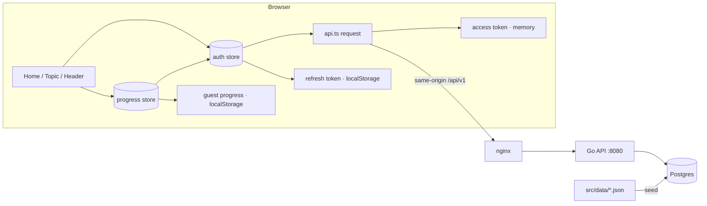

# Frontend ↔ Go API integration

## Overview

Frontend hiện đọc nội dung từ `src/data/**/*.json` qua `import.meta.glob` và giữ tiến độ
trong `localStorage`. Backend Go + Postgres đã hoàn chỉnh (topics, Google auth, progress)
nhưng FE chưa gọi endpoint nào. Plan này nối FE vào API theo reframing đã xác nhận:
auth + progress + content read-path + deploy same-origin, giữ guest-first.

Bằng chứng nền:

- `src/lib/progress.ts` — `localStorage` là source of truth, 4 component dùng trực tiếp.
- `src/lib/vocab.ts:24` — `import.meta.glob` nạp toàn bộ module; topic page tải cả 3.1 MB.
- `backend/internal/server/router.go:54-69` — endpoint khả dụng.
- `backend/internal/dto/topic_dto.go` — `TopicSummary.orderIndex/itemCount`, `TopicDetail.items`.
- `backend/internal/auth/token_service.go:53-92` — refresh token single-use, replay revoke toàn bộ.
- `backend/internal/handler/respond.go:39` — `ETag` + `Cache-Control: max-age=86400, stale-while-revalidate=3600`.

## Goals

| # | Goal | Priority |
|---|------|----------|
| 1 | Tiến độ theo tài khoản, sống qua đổi máy/xoá cache | P1 |
| 2 | Guest học ngay, không cần đăng nhập | P1 |
| 3 | Nội dung do API phục vụ; `src/data` chỉ còn là seed | P1 |
| 4 | Deep-link topic không tải toàn bộ dữ liệu | P2 |
| 5 | Không để API lỗi biến thành màn hình trắng | P2 |

## Constraints

- Không sửa code Go, không đổi DTO shape trong plan này.
- Giữ chữ ký export của `src/lib/progress.ts`: `useLearned`, `useTotalLearned`, `toggleLearned`, `getLearned`.
- Refresh token trong `localStorage` (body token) — đã chốt; access token chỉ trong memory.
- Refresh lỗi ở boot (kể cả mạng/5xx) → xoá `engstack.auth.v1` và về `guest`; chỉ xoá khi token
  đang lưu vẫn là token đã gửi (compare-and-delete trong lock, tránh xoá token vừa rotate ở tab khác).
- Union semantics cho merge tiến độ (`import-guest` là additive).
- Cache `GET /topics` bằng query `?v=${VITE_CONTENT_VERSION}`; bump biến này mỗi lần seed đổi dữ liệu.
- `make deploy` fail-fast khi thiếu `VITE_GOOGLE_CLIENT_ID`.
- Cross-tab logout: tab khác thấy `engstack.auth.v1` bị xoá → về `guest` ngay (interim). Denylist
  access token phía Go (Redis) nằm ngoài scope này — tách plan riêng (xem Follow-ups).
- Tuân thủ `design-system/engstack/MASTER.md`; UI tiếng Việt; icon `lucide-react`.
- Không thêm thư viện data-fetching/HTTP client.

## Non-goals

Authoring CRUD, PWA/offline, spaced repetition, last-write-wins merge, chuyển sang cookie
auth, SSR/SEO rendering, đồng bộ tiến độ nhiều thiết bị khi chưa login.

## Boot sequence (ràng buộc xuyên phase)

1. App khởi động → `auth.status = "loading"`.
2. Nếu có refresh token đã lưu → refresh **một lần** trong `navigator.locks("engstack:refresh")`,
   đọc lại token trong lock, adopt nếu tab khác đã rotate. Refresh lỗi → compare-and-delete token
   đã gửi rồi `status = "guest"`.
3. `status = "authenticated"` → `GET /progress` → hydrate store → render số đã thuộc.
   `status = "guest"` → đọc guest progress từ `engstack.learned.v2`.
4. Trong lúc `loading`: header và progress bar render skeleton/`—`, **không** hiển thị 0,
   **không** đọc `engstack.learned.v2` như server truth (sau login key này đã bị xoá).

## Phases

| # | Phase | Status |
|---|-------|--------|
| 1 | [Phase 1: API Client & Auth Store](./phase-01-start.md) | Pending |
| 2 | [Phase 2: Progress Store](./phase-02-progress-store.md) | Pending |
| 3 | [Phase 3: Content API](./phase-03-content-api.md) | Pending |
| 4 | [Phase 4: Auth UI](./phase-04-auth-ui.md) | Pending |
| 5 | [Phase 5: Deploy Proxy & Docs](./phase-05-deploy-proxy.md) | Pending |
| 6 | [Phase 6: Verification](./phase-06-verification.md) | Pending |

Dependency: 1 → 2 → 4; 1 → 3; 1..4 → 5; tất cả → 6. Phase 3 độc lập với 2/4 về file.

## Architecture

## Risks

| Risk | Mitigation |
|---|---|
| Hai tab refresh đồng thời → revoke toàn bộ session | `navigator.locks` + single-flight + đọc lại token trong lock (phase 1) |
| UI flash 0 khi reload với token đã lưu | `useProgressReady()` chặn number ở header/home/topic (phase 2, 3, 4) |
| learn-mode snapshot `getLearned` không nhận hydration | chuyển sang `useLearned` (phase 2) |
| v1 migration cần mọi module | gate bằng sự tồn tại của `engstack.learned.v1`, fetch all detail một lần (phase 2) |
| Rollback toggle lỗi không tới UI | store sở hữu optimistic state, component chỉ subscribe (phase 2) |
| Race import-guest vs `GET /progress` | `sessionRestore()` tuần tự, hydrate chỉ gọi từ đó (phase 2) |
| Khối "Chủ đề liên quan" mất khi bỏ `useTopics` | topic page dùng cả `useTopic` và `useTopicSummaries` (phase 3) |
| Nội dung seed lại bị cache 24h | `cache: "no-cache"` cho detail, revalidate qua `ETag` (phase 3) |
| Tab B adopt token nhưng vẫn ở trạng thái guest | storage handler → `sessionRestore()` (phase 1, 2) |
| `make deploy` chạy web container ngoài compose network → `backend:8080` không resolve, 502 | `--network $(COMPOSE_NETWORK)` + health check `/api/v1/health` trong deploy (phase 5) |
| Vite inline `VITE_GOOGLE_CLIENT_ID` lúc build, image không có ARG → không có client ID | `ARG`/`ENV` trong Dockerfile + `--build-arg` ở `make docker-build` (phase 5) |
| API lỗi → trắng trang | error + retry ở cả hai trang (phase 3) |
| Refresh **boot** lỗi (401/5xx/mạng) → xoá token, user phải login lại | Chấp nhận (validation 3). Giữa phiên, timer refresh chỉ xoá khi 401/token chết; lỗi mạng không đăng xuất (phase 1). Compare-and-delete tránh xoá token vừa rotate ở tab khác |
| Logout tab A, tab B vẫn authenticated tới 15 phút (JWT stateless) | Interim: storage removal → guest + clear server map (phase 1, 2); denylist Redis là plan riêng (Follow-ups) |
| `GET /topics` cache 24h → `itemCount`/`related` cũ sau reseed | Query `?v=${VITE_CONTENT_VERSION}`; bump + rebuild/deploy khi seed đổi (phase 3, 5, 6) |
| Deploy image prod không có client ID → không có nút login | `make deploy` fail-fast khi `VITE_GOOGLE_CLIENT_ID` rỗng (phase 5) |

## Success Criteria

- [ ] `grep -rn "src/data" src/` chỉ còn comment; không còn import thật
      (`grep -rnE "(from|import\\()\\s*[\"'][^\"']*data/" src/` = 0); `grep -rn "useTopics" src/` = 0.
- [ ] Guest học 3 từ → reload còn nguyên; key `engstack.learned.v2` tồn tại.
- [ ] Login lần đầu: DB có union(local, server); key local biến mất.
- [ ] Toggle ở tab A → tab B cùng tài khoản thấy sau reload.
- [ ] Logout ở tab A → tab B về `guest` và số đã thuộc không còn của tài khoản cũ.
- [ ] Reseed dữ liệu + bump `VITE_CONTENT_VERSION` + rebuild/deploy → `GET /topics` lấy bản mới,
      không chờ 24h (Vite inline biến lúc build).
- [ ] `make deploy` fail khi `VITE_GOOGLE_CLIENT_ID` rỗng.
- [ ] Reload khi đã login: không có frame nào hiển thị "Đã thuộc: 0 từ".
- [ ] Hai tab cùng hết hạn access token → không tab nào bị đăng xuất.
- [ ] API tắt: home và topic hiện error + nút "Thử lại", không uncaught exception.
- [ ] `/topic/oxford-b2` giữ khối "Chủ đề liên quan" và chỉ tải 2 request nội dung.
- [ ] Chunk JS lớn nhất < 400 KB (không còn dữ liệu vocab trong bundle).
- [ ] `npm run typecheck && npm run build && npm run lint` pass.
- [ ] `bash backend/scripts/test-e2e.sh` pass.
- [ ] Build prod: `/api/v1/health` trả 200 trên cùng origin.

## Follow-ups

| # | Item | Lý do | Trạng thái |
|---|------|-------|------------|
| 1 | Denylist access token ở Go (Redis) + test replay | Logout/revoke hiện chỉ chạm refresh token; access JWT còn hạn 15 phút vẫn dùng được ở tab/thiết bị khác. Cần sửa Go + thêm Redis, trái constraint của plan này. Blocker kỹ thuật: access token không có `jti`/`sid` (`backend/internal/jwt.go:38-50`) và `Logout` chỉ nhận `refresh_token` (`backend/internal/handler/auth.go:90-100`) — plan mới phải thêm `sid` dùng chung cho cặp access+refresh (giữ qua rotation), denylist TTL = access TTL, middleware check mọi route protected. | Chưa lập plan — tạo `plans/<ts>-go-token-denylist/plan.md` trước khi làm, theo quyết định Validation Session 3 |

## Validation Log

### Verification Results

- Claims checked: 12
- Verified: 12 | Failed: 0 | Unverified: 0
- Tier: Full (6 phases)
- Evidence: `src/lib/progress.ts:95-140`, `src/lib/vocab.ts:24-46`,
  `src/components/modes/learn-mode.tsx:25-26,71`, `src/pages/home.tsx:59,77`,
  `src/pages/topic.tsx:61-62`, `src/components/site-header.tsx:6,10`,
  `backend/internal/server/router.go:54-69`, `backend/internal/dto/topic_dto.go:4-40`,
  `backend/internal/auth/token_service.go:53-92`, `backend/internal/handler/respond.go:39-57`,
  `backend/scripts/test-e2e.sh:27-89`, `package.json` (không có test framework).

## Red Team Review

### Session — 2026-10-19

Subagent delegation was unavailable in this runtime (`No model selected` from the `code-reviewer`
runner), so the four lenses were executed directly by the orchestrator against the repository.
Every finding below carries `file:line` evidence, checked by grep/read during this session.

**Findings:** 15 (14 accepted, 1 rejected)
**Severity breakdown:** 1 Critical, 6 High, 8 Medium

| # | Finding | Severity | Disposition | Applied To |
|---|---------|----------|-------------|------------|
| 1 | `AUTH_DEV_MODE=true` + static `JWT_SECRET` in compose allows impersonating any email if copied to prod (`docker-compose.yml:29,31`) | Critical | Accept | Phase 5 |
| 2 | Topic page renders "Chủ đề liên quan" from the full list; removing `useTopics` drops the section (`src/pages/topic.tsx:111,273-279`) | High | Accept | Phase 3 |
| 3 | import-guest vs `GET /progress` race: status flip can hydrate pre-import state (`phase-02`, `backend/internal/handler/progress.go:36-58`) | High | Accept | Phase 2 |
| 4 | Progress shows 0 while hydrating on home/topic (`src/pages/home.tsx:25`, `src/pages/topic.tsx:63`) | High | Accept | Phase 2, 3 |
| 5 | Tab B adopts tokens via `storage` but never hydrates, staying visually guest (`phase-01` listener) | High | Accept | Phase 1, 2 |
| 6 | `server.proxy` does not apply to `vite preview`; phase 5 verification was false (`vite.config.ts:7-13`) | High | Accept | Phase 5 |
| 7 | `docker-compose.yml` has no `web` service, so the nginx same-origin `curl` was unverifiable (`docker-compose.yml:4,21`) | High | Accept | Phase 5 |
| 8 | Content cached `max-age=86400` with no invalidation; reseed invisible up to 24h (`backend/internal/handler/respond.go:39`) | Medium | Accept | Phase 3 |
| 9 | `migrateLearnedToItemIds(modules: Topic[])` breaks once `Topic` loses loader context (`src/lib/progress.ts:41-45,78`) | Medium | Accept | Phase 2 |
| 10 | DTO `pos` is `string[]`, FE type is `PartOfSpeech[]`; plan allowed a blind cast (`backend/internal/dto/topic_dto.go:34`, `src/lib/vocab-schema.ts:54`) | Medium | Accept | Phase 3 |
| 11 | StrictMode/HMR double bootstrap would issue two refreshes and trigger replay revocation (`src/main.tsx:7-11`, `backend/internal/auth/token_service.go:66-75`) | Medium | Accept | Phase 1 |
| 12 | Dev login button is unrequested scope; justified only as the verification path until a real Google client ID exists (`backend/internal/config/config.go:19-25`) | Medium | Accept (modified: DEV-gated only) | Phase 4 |
| 13 | Plan did not enumerate all consumers of changed symbols (`useTopics`, `useLearned`, `getLearned`, `toggleLearned`, `Topic`) | Medium | Accept | Phase 3 |
| 14 | Phase 6 bundle check (`grep "collocation"`) was not observable | Medium | Accept | Phase 6 |
| 15 | Refresh token in `localStorage` is XSS-readable for 30 days | Medium | Reject — explicit user decision recorded in Constraints/Trade-offs; not a plan defect | — |

### Verification Results (red team)

- Claims checked: 15
- Verified: 15 | Failed: 0 | Unverified: 0
- Contract consumers enumerated: `useTopics` (`src/pages/home.tsx:67`, `src/pages/topic.tsx:61`);
  `useLearned` (`src/pages/home.tsx:25`, `src/pages/topic.tsx:63`); `useTotalLearned`
  (`src/components/site-header.tsx:10`); `getLearned`/`toggleLearned`
  (`src/components/modes/learn-mode.tsx:26,71`); `labelText`
  (`learn-mode.tsx:218`, `word-list.tsx:47`); `validateTopicSource` (`scripts/data-check.ts:46`).

### Session 2 — 2026-10-19

Follow-up review against `Makefile`, `Dockerfile`, `src/lib/vocab-schema.ts`. **3 accepted, 2 rejected
as already fixed in Session 1.**

| # | Finding | Severity | Disposition | Applied To |
|---|---------|----------|-------------|------------|
| 1 | `make deploy` runs the web container on the default bridge (`Makefile:113,125`), so `proxy_pass http://backend:8080` returns 502 in the real production path | High | Accept | Phase 5 |
| 2 | `Dockerfile` has no `ARG` for `VITE_GOOGLE_CLIENT_ID`; Vite inlines it at build, so the deployed image has no client ID | High | Accept | Phase 5 |
| 3 | `grep -rn "src/data" src/` false-positives on the comment at `src/lib/vocab-schema.ts:64` | Medium | Accept | Phase 3, 6, plan.md |
| 4 | Topic page loses the related-topics section | High | Reject — fixed in Session 1 (`phase-03` requirements 21-23, step 3) | — |
| 5 | `vite preview` ignores `server.proxy` | High | Reject — fixed in Session 1 (phase 5 uses `npm run dev`) | — |

Also tightened in Session 2: `loginWithGoogle` no longer flips `status = authenticated` before
`sessionRestore()` resolves (`phase-01` step 2), and the progress store owns `onSessionEstablished()`.

### Whole-Plan Consistency Sweep

- Files reread: `plan.md`, `phase-01-start.md` … `phase-06-verification.md`
- Decision deltas checked: 14 accepted findings
- Reconciled stale references: 4 — hook naming unified to `useProgressReady()`
  (phase 2/3/4), login order unified to `sessionRestore()` (phase 2),
  deep-link request count corrected from 1 to 2 (phase 3/6), bundle check replaced (phase 6)
- Session 2 deltas: deploy network/build-arg added to phase 5 (files list, steps 6-7, verification),
  grep gate narrowed in phase 3/6/plan.md, auth status transition aligned in phase 1/2
- Unresolved contradictions: 0

<!-- slug: fe-api-integration -->

## Validation Log — Session 3

**Trigger:** `/ak:plan validate plans/261019-1636-fe-api-integration/plan.md`
**Questions asked:** 6 (2 vòng, vòng 2 để giải quyết xung đột Redis/version source)

### Verification Results

- Claims checked: 33
- Verified: 33 | Failed: 0 | Unverified: 0
- Tier: Full (6 phases)
- Evidence: `src/lib/progress.ts:5,7,41,95,106,117,122`; `src/lib/vocab.ts:7,24,52,82,105-131`;
  `src/lib/vocab-schema.ts:14,32,58,64`; `src/components/modes/learn-mode.tsx:26,71`;
  `src/components/site-header.tsx:6,10`; `src/pages/home.tsx:25,59,67,77`;
  `src/pages/topic.tsx:61,63,111,273`; `src/main.tsx:7-11`; `index.html` (không có GIS script);
  `.env.example` (chỉ có `TRANSLATE_*`); `vite.config.ts` (không có proxy);
  `nginx.conf` (không có `location /api/`); `Dockerfile` (không có `ARG VITE_*`);
  `Makefile:106-130` (không có `--network`, không có `--build-arg`, health chỉ `/healthz`);
  `docker-compose.yml` (chỉ `postgres`, `backend`; `AUTH_DEV_MODE: "true"`, `JWT_SECRET` tĩnh);
  `backend/internal/server/router.go:45-62`; `backend/internal/dto/topic_dto.go:4-40`;
  `backend/internal/auth/token_service.go:53-92`; `backend/internal/handler/respond.go:28,41`;
  `backend/internal/handler/progress.go:40-66`; `backend/internal/handler/auth.go:90-101`;
  `backend/go.mod` (không có Redis); `package.json` (không có test framework).
- New findings:
  1. Logout chỉ revoke refresh token (`auth.go:96`); access JWT stateless vẫn hợp lệ tới 15 phút
     ở tab khác — cần quyết định cross-tab (đã hỏi).
  2. Refresh lỗi lúc boot chưa phân biệt 401 với lỗi mạng; xoá token không điều kiện sẽ xoá mất
     token vừa rotate ở tab khác (đã thêm compare-and-delete).

#### Questions & Answers

1. **[Risk]** Refresh lúc boot lỗi mạng/5xx (token còn hạn) xử lý thế nào?
   - Options: Giữ token, guest tạm, thử lại khi online/focus | Xoá token, về guest hẳn | Giữ loading đến khi mạng trở lại
   - **Answer:** Xoá token, về guest hẳn
   - **Impact:** `bootstrapAuth()` xoá `engstack.auth.v1` khi refresh fail; user phải đăng nhập lại.
     Bắt buộc compare-and-delete trong lock để không xoá token do tab khác vừa rotate.

2. **[Risk]** Logout tab A, tab B (access token còn hạn) vẫn thấy tiến độ server — xử lý?
   - Options: storage listener → guest + clear server map | giữ đến 401 kế tiếp | polling `/auth/me`
   - **Custom input:** "invoke token check stage qua redis"
   - **Answer (vòng 2, sau khi xác minh stack):** Mở scope: thêm Redis denylist ở Go (plan mới)
   - **Impact:** Backend không có Redis (`go.mod`, `docker-compose.yml` đều không có), và plan này
     cấm sửa Go. Interim trong plan này: storage removal → guest + clear server map; denylist
     Redis thành Follow-up #1 (plan riêng).

3. **[Architecture]** `/topics` vẫn `max-age=86400` sau khi detail chuyển `no-cache` — policy?
   - Options: no-cache cả hai | giữ 24h cho list | thêm version query
   - **Answer:** Thêm version query cho list
   - **Follow-up (vòng 2):** nguồn version = `VITE_CONTENT_VERSION` bump thủ công khi seed
     (không dùng build timestamp).

4. **[Scope]** `make deploy` với `VITE_GOOGLE_CLIENT_ID` rỗng → prod không có nút login?
   - Options: fail-fast | deploy guest-only + cảnh báo | banner runtime
   - **Answer:** Fail-fast khi thiếu `VITE_GOOGLE_CLIENT_ID`

5. **[Architecture]** (vòng 2) "Token check qua Redis" trái constraint — chọn hướng nào?
   - Options: `/auth/me` khi tab focus + storage listener | mở scope Redis denylist (plan mới) | chỉ storage listener
   - **Answer:** Mở scope: thêm Redis denylist ở Go (plan mới)

6. **[Architecture]** (vòng 2) Nguồn version query cho `GET /topics`?
   - Options: `VITE_CONTENT_VERSION` bump thủ công | build timestamp | env nếu có, fallback timestamp
   - **Answer:** `VITE_CONTENT_VERSION` bump thủ công khi seed

#### Confirmed Decisions
- Refresh fail ở boot (mọi lỗi 401/5xx/mạng) → xoá token đã gửi nếu nó vẫn là token đang lưu →
  guest; timer giữa phiên chỉ xoá khi 401/token chết.
- Cross-tab logout: interim bằng storage listener; denylist Redis tách plan Go riêng.
- List cache: `?v=${VITE_CONTENT_VERSION}`, bump tay sau mỗi lần seed đổi dữ liệu; prod phải
  rebuild/deploy vì Vite inline biến lúc build.
- Deploy: fail-fast khi thiếu `VITE_GOOGLE_CLIENT_ID`.

#### Action Items
- [x] plan.md: Constraints, Boot sequence, Risks, Success Criteria, Follow-ups.
- [x] phase-01: compare-and-delete + storage removal → guest.
- [x] phase-02: `clearServerProgress()` khi mất session.
- [x] phase-03: `?v=` cho `/topics`, hằng `CONTENT_VERSION`.
- [x] phase-05: build arg + `.env.example` cho `VITE_CONTENT_VERSION`; fail-fast client ID.
- [x] phase-06: thêm dòng smoke logout chéo tab, reseed + bump version, deploy fail-fast.
- [x] Post-sweep: scope xoá token (boot mọi lỗi / timer chỉ 401), `onSessionLost()` ở nhánh refresh
      fail, "bump + rebuild/deploy" ở mọi chỗ, hydrate retry + reset promise, phase-5 positive case
      không redeploy, guard bundle version.
- [ ] Tạo plan `go-token-denylist` (Redis) — Follow-up #1, không chặn plan này.

#### Impact on Phases
- Phase 1: refresh failure semantics + listener nhánh token bị xoá.
- Phase 2: xoá server map khi session mất.
- Phase 3: URL list có version; detail giữ `no-cache`.
- Phase 5: build arg mới, guard deploy.
- Phase 6: 3 kịch bản smoke mới.

### Whole-Plan Consistency Sweep (re-run sau propagation)

- Files reread: `plan.md`, `phase-01-start.md` … `phase-06-verification.md`
- Grep kiểm tra (chạy lại sau toàn bộ edit):
  - `grep -rn "mọi loại lỗi\|Refresh fail (401/5xx/mạng)\|Refresh boot lỗi mạng" plan.md phase-*.md | grep -v "^plan.md:325"`
    → **0 hits** (chỉ còn dòng lệnh tự tham chiếu trong sweep). Wording hiện tại tách boot (mọi lỗi)
    vs timer (chỉ 401/token chết) ở plan.md risk + decision và phase-01 requirement/step.
  - `grep -rn "bump.*VITE_CONTENT_VERSION" plan.md phase-*.md` → 3 hits ngoài sweep
    (`plan.md:134`, `phase-06:56`, `phase-06:88`), cả 3 đều kèm "rebuild/deploy".
- Mâu thuẫn đã sửa sau sweep đầu:
  1. Token deletion scoped: boot xoá mọi lỗi, timer giữa phiên chỉ xoá khi 401/token chết
     (plan.md:121, phase-01:25-28, phase-01:65-69).
  2. Version bump chỉ có hiệu lực sau rebuild: plan.md:134-135, phase-03:33-36, phase-06:56,88.
  3. `onSessionLost()` gọi cả ở nhánh refresh fail (phase-01:66-67), không chỉ storage removal.
  4. Hydration retry: promise reset khi reject + retry `online`/`visibilitychange`
     (phase-02:34-36,63-64; phase-06 row 17).
- Mâu thuẫn còn lại: **0**.
- Ghi chú: `no-cache` cho detail và `?v=` cho list là hai policy cho hai endpoint — không mâu thuẫn.
